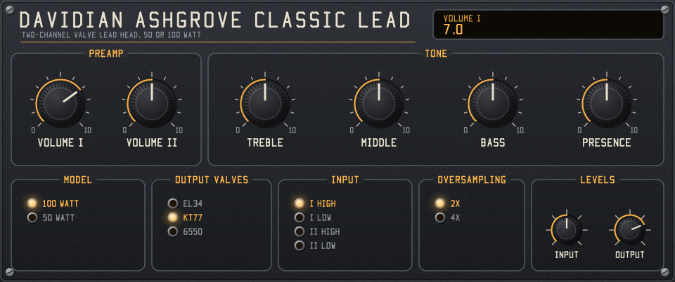
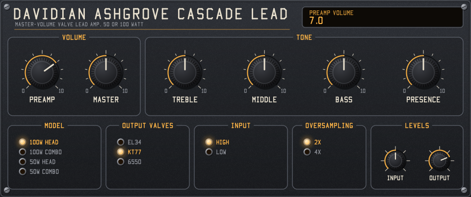
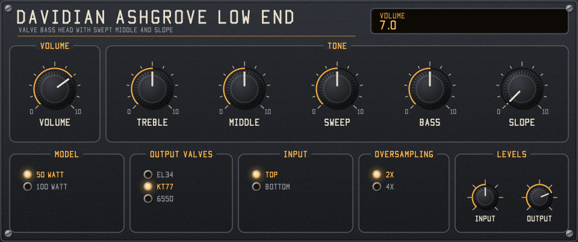
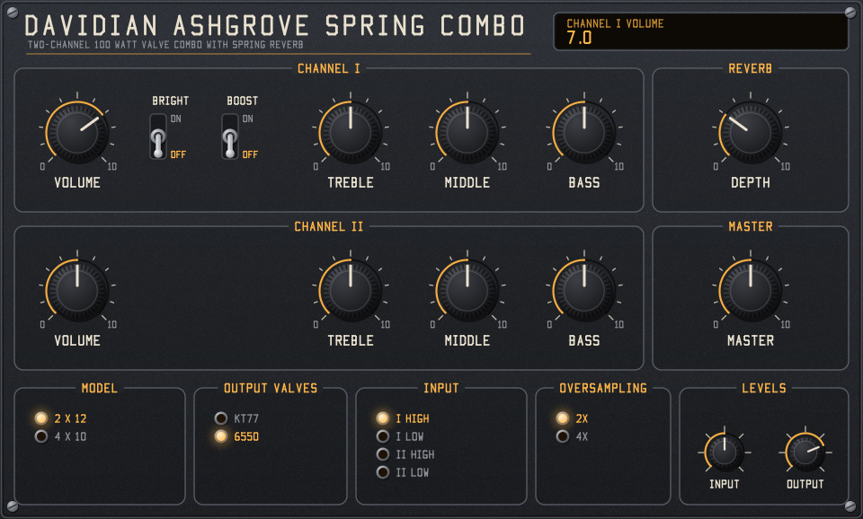
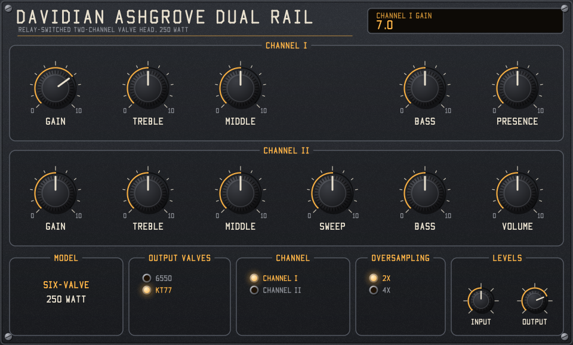

# Davidian Ashgrove — LV2 amp plugins

Davidian LV2 models of 11 valve amps from a classic 1980s British amp range, solved at circuit level from the
service-manual schematics. They come as five mono plugins, one per amp family, each with a model selector and a choice
of output valves. Plugin URIs start with `urn:davidian:ashgrove-`. Made with AI assistance; see [Use of AI](#use-of-ai).

| Plugin | Models | Output valves |
|---|---|---|
| Classic Lead | CL100 (100 W head), CL50 (50 W head) | EL34, KT77, 6550 |
| Cascade Lead | CH100, CC100 (100 W head, combo), CH50, CC50 (50 W head, combo) | EL34, KT77, 6550 |
| Low End | LE50 (50 W), LE100 (100 W) bass heads | EL34, KT77, 6550 |
| Spring Combo | SC212 (2x12), SC410 (4x10) | KT77, 6550 |
| Dual Rail | DR250 (250 W head) | 6550, KT77 |

The output valves offered are the ones each spec sheet lists. The manual draws CC100/CH100, CC50/CH50 and SC212/SC410
the same, so each pair sounds the same here.

## Build and test on Windows

```bash
sh build.sh
```

```bash
sh run_checks.sh
```

`build.sh` runs from Git Bash and needs Visual Studio 18 with its C++ tools and CMake. Edit `VS` at the top if your
install is somewhere else. `run_checks.sh` rebuilds, then runs every check and writes the results to `build/`.

- `spec_test.exe` measures every model against its spec sheet (power, sensitivity, tone ranges, boost, bright, reverb)
  and the manual's DC voltage table. Results in `build/spec_results.txt`.
- `idle_check.exe` runs each model with no input, at half and full controls, and reports any oscillation. Results in
  `build/idle_results.txt`.
- `host_check.exe` checks the bundle with the lilv LV2 parser (the one most hosts use), without installing it, and
  runs every model, valve and input combination. It loads lilv from Ardour 9, so it needs Ardour 9 installed in
  `C:\Program Files\Ardour9`. Results in `build/host_results.txt`.
- `ui_ports_check.exe` checks that every panel control sits on the right port with the plugin's default and range.
- `ui_check.exe` loads the GUI the way a Windows host does and drives each panel with mouse messages.
- `ui_render.exe` renders every panel to a .bmp without opening a window.

## Install

Ashgrove is Windows-only (64-bit) for now: the GUI is a Win32 window, and only the Windows build has been compiled and
tested. The build needs a CPU with AVX2.

Copy the whole `build\lv2\ashgrove.lv2` folder (`ashgrove.dll`, `ashgrove_ui.dll` and the two .ttl files) into one of
the standard Windows LV2 folders: `%APPDATA%\LV2` (current user) or `%COMMONPROGRAMFILES%\LV2` (all users).

If your host doesn't scan that folder, add it to the host's LV2 search path or set the `LV2_PATH` environment variable.
Close the host before copying and restart it afterwards. Replace any older copy instead of keeping two: when two bundles
have the same URI, the loader uses one and ignores the other.

Look for **Davidian Ashgrove** in your host's plugin list.

## GUI

Each plugin has its own panel in the house style: graphite panel, cream lettering, amber accents, black knurled knobs
and outlined section boxes. The style lives in `src/ui/style.h` (palette and text sizes), `font.h` (stroke font) and
`canvas.h` (renderer). The GUI draws with its own software renderer into a Win32 window (`ui:WindowsUI`), so it needs no
graphics libraries. Other hosts fall back to generic controls.

- **Knobs:** drag up or down. Hold Shift for fine control, use the mouse wheel for small steps, and double-click to reset.
- **Selectors:** click a row to choose it. The lit amber lamp is the current choice.
- **Toggles:** up is on.
- **Readout:** the window at the top right shows the control you last touched and its value.

The panel names are original. The panels use none of the original amps' logos, wordmarks or artwork.

### Classic Lead



Two-channel lead head with no master volume. Volume I and Volume II set each channel's level, and the four inputs pick
the channel and the high or low jack.

### Cascade Lead



Master-volume lead amp. Preamp sets the gain into the cascaded stage, and Master sets the level into the power amp.

### Low End



Bass head with a swept middle. Mid Sweep moves the middle control between about 400 Hz and 1 kHz, and Slope tilts the
response.

### Spring Combo



Two-channel combo with spring reverb. Channel I has Bright and Boost switches. Both channels share the reverb and the
master volume.

### Dual Rail



Relay-switched two-channel 250 W head. Channel II adds a mid sweep and its own volume. The Channel selector stands in
for the relay footswitch.

## Controls

Every panel has these:

| Control | Range | Default | Notes |
|---|---|---|---|
| Model | Family's models | First | Rebuilds the circuit behind a short fade |
| Output Valves | Spec sheet's list | First | Changes the power-valve curves and bias |
| Input / Channel | Family's jacks | First | High and low jacks, or channels |
| Oversampling | 2x / 4x | 2x | 4x costs about twice the CPU |
| Input Trim | -36 to +36 dB | 0 dB | 0 dBFS at the input counts as 1 V peak at the amp's jack |
| Output Level | -60 to +12 dB | -6 dB | 0 dBFS before this control is rated power into the rated load |

Amp knobs run 0 to 10, as on the panels, and default to 5. Slope defaults to 0 and reverb depth to 3. Model, valve,
input and oversampling changes rebuild the circuit, so don't automate them.

| Plugin | Amp controls |
|---|---|
| Classic Lead | Volume I, Volume II, Treble, Middle, Bass, Presence |
| Cascade Lead | Preamp, Master, Treble, Middle, Bass, Presence |
| Low End | Volume, Treble, Middle, Mid Sweep, Bass, Slope |
| Spring Combo | Ch I Volume, Bright, Boost, Treble, Middle, Bass; Reverb Depth; Ch II Volume, Treble, Middle, Bass; Master |
| Dual Rail | Ch I Gain, Treble, Middle, Bass, Presence; Ch II Gain, Treble, Middle, Mid Sweep, Bass, Volume |

The output is the speaker-terminal signal with no cabinet. Add a speaker impulse response after the plugin. Latency is
16 samples and is reported to the host.

## How the model works

- **Circuit solver:** each amp is entered as its schematic: resistors, capacitors, pots, valves and the output
  transformer. A nonlinear state-space (DK-method) solver runs it every sample, using trapezoidal companion models for
  the capacitors and damped Newton iteration on the valves, with a line search and a fallback for hard overdrive.
- **Valves:** ECC83/12AX7 triodes and EL34, KT77 and 6550 pentodes use Koren's equations, built into lookup tables.
  Grid current is modelled, so stages block and clip as they do in the real amps.
- **Sections:** the amp is solved in sections (preamp, tone stack, phase splitter, power amp), with supply rails and
  currents passed between them, so the power supply sags under load.
- **Power amp:** push-pull pairs into an output transformer, modelled as an ideal centre tap with its inductance and
  load, including the presence and feedback networks.
- **Spring reverb:** the Spring Combo's tank is a separate DSP model, set to the level and decay the spec sheet gives.
- **Oversampling:** the whole circuit runs at 2x or 4x behind windowed-sinc filters.

## Measured against the manual

Measured at 48 kHz with 2x oversampling. The sheets don't say where the other controls sat, so tone figures are shown
for the setting named in each row.

### Close to the manual

| Check | Model | Manual |
|---|---|---|
| DC voltages, 17 test points in 4 configurations | Mostly within 5-10%; see below for points 11 and 14 | Table |
| Power, CL100/CH100 EL34 | 127 W at 4% THD | 115 W |
| Power, CL50/CH50 EL34 | 54 W at 3% THD | Over 50 W |
| Power, LE50 EL34 | 51 W at 3% THD | Over 50 W |
| Power, LE100 EL34 | 130 W at 3% THD | Over 100 W; 135 W at clipping |
| Power, SC212 KT77 / 6550 | 132 W / 120 W at 4% THD | 120 W |
| Power, DR250 6550 | 249 W at 5% THD | 250 W |
| Sensitivity, CL100, CL50, CH100, CH50 | 1.2, 0.87, 0.19, 0.15 mV | 1, 1, 0.15, 0.1 mV |
| Sensitivity, LE50, LE100, DR250 Ch I | 5.1, 18, 0.49 mV | 6, 12, 0.7 mV |
| SC212 boost / bright | +10.2 dB / +17.4 dB | +11 dB / +16 dB |
| Low input | -6.0 dB | -6 dB |
| SC212 reverb level / decay (calibrated to the sheet) | +17.0 dB / 3.0 s | +17 dB / 3 s |
| Lead bass, others down | 15.3 dB | 15 dB |
| Bass amps: treble / bass / slope | 46.5 / 34.7 / -18.2 dB | 48 / 34 / -20 dB |
| Bass amps: mid sweep range | Deepest cut moves from 1 kHz to 400 Hz | 400 Hz-1 kHz |
| SC212 mid, Ch I / Ch II | 15.4 / 17.3 dB | 15 / 17 dB |
| SC212 treble and bass, mid down | 41.9-43.1 / 36.6-38.9 dB | 37-40 / 34 dB |

DC points 11 and 14 (splitter grids) read 33-38 V against 23-25 V in the table. They sit behind 1M resistors, so a
meter of that era would load them down; the points beside them match. This is an explanation, not something the
manual says.

### Misses

| Check | Model | Manual |
|---|---|---|
| Lead treble (others down) | 31 dB on all of them | CL100/CH100 35, CH50 32, CL50 26 dB |
| Lead mid | 5.4-7.1 dB | 9.5 dB |
| Presence, CL100/CH100, CL50/CH50 | 10 dB, 8.7 dB | 6 dB |
| Bass amp mid | 13.7-16.6 dB | 18 dB |
| DR250 bass, Ch I / Ch II | 14.3 dB both | 24 / 25 dB |
| DR250 treble Ch II | 35 dB | 40 dB |
| DR250 mid | 9.7-10 dB | 12 dB |
| DR250 presence | 15 dB | 13 dB |
| SC212 sensitivity | 12.4-13.2 mV | 3.5 mV |
| 50 W models with 6550 | 33 W at 3% THD | Over 50 W |
| DR250 with KT77 | 49 W at 5% THD, then 308 W at 10% | No KT77 figure |
| Power at 10% THD, CL100 | 143 W into 16 ohms | 170 W into 4 ohms |
| Power at 10% THD, CL50/CH50 | 62 W into 16 ohms | 90 W into 16 ohms |

The CL100 and CL50 sheets give different treble figures for one shared drawing, so the model can't match both. The
same applies to CH100 and CH50.

## Estimates

The manual doesn't give these, so they are guesses. Tune them by ear:

- **Valve curves:** ECC83 is Koren's fit, trimmed to the manual's DC table. EL34 and 6550 use Koren values recalled
  from memory, and KT77 is an estimate with no published fit.
- **Transformers and supply:** output transformer inductances and impedance (impedance is set from rated power), choke
  values and supply stiffness.
- **Bias:** EL34 uses the marked voltage, except the LE50, which uses -29 V instead of "approx -26 V" to stay under the
  25 W plate rating. KT77 and 6550 are set to a target idle current. The DR250's 6550 sits at -86 V, not the
  bulletin's -75 V, which would far exceed the 6550's rating on this valve fit.
- **HT voltages:** SC212 465 V and DR250 640 V.
- **Spring tank:** delay times and tone. Only its type, level and decay come from the manual.

Doubtful schematic readings, each assumed as stated in `src/amp.cpp`:

- The DR250 volume pot reads "1K log"; 1M is assumed.
- DR250 Ch I has no visible third-stage coupling cap; .022 uF is assumed to match Ch II.
- The SC212 reverb pot is assumed to be 250K.
- The SC212's dry resistor reads 6M8. It may explain the SC212 sensitivity miss, so it's the first value to recheck.

## Simplifications

- Output valves are matched pairs into a resistive load, with no speaker impedance curve.
- No cabinet simulation. Use your own impulse response.
- Effects loops, preamp out, the DR250's DI output and the footswitches aren't modelled. Boost, Reverb and the
  channel choice are controls instead.
- One more model in the manual isn't included yet.

## Code layout

| File | Contents |
|---|---|
| `src/circuit.h` | The nonlinear circuit solver |
| `src/tubes.h` | Valve equations, lookup tables and bias solving |
| `src/amp.h`, `amp.cpp` | The amp circuits, one builder per family |
| `src/spring.h` | Spring reverb |
| `src/oversampler.h` | Oversampling filters |
| `src/plugin.cpp` | LV2 entry points |
| `src/ports.h` | Port tables shared by the plugin, the Turtle generator and the tests |
| `src/lv2_abi.h` | The LV2 C interface, so no SDK is needed |
| `src/ui/layouts.h` | The five panel layouts |
| `src/ui/panel.h` | GUI drawing and mouse handling, with no platform code |
| `src/ui/style.h`, `canvas.h`, `font.h` | House style, software renderer and stroke font |
| `src/ui/ui_lv2.c` | LV2 UI entry points and the Win32 window layer |
| `tools/gen_ttl.cpp` | Writes `manifest.ttl` and `ashgrove.ttl` from the port tables at build time |
| `tests/spec_test.cpp` | Measures every model against the manual |
| `tests/idle_check.cpp` | Checks for oscillation with no input |
| `tests/host_check.cpp` | Checks the bundle with lilv and runs every combination |
| `tests/ui_ports_check.cpp` | Checks the panels against the plugin ports |
| `tests/ui_check.c` | Hosts the built GUI and drives it with mouse messages |
| `tests/ui_render.c` | Renders every panel to a .bmp file |

## References

The model re-implements equations from these published works. No code was copied from them.

1. N. Koren, "Improved vacuum tube models for SPICE simulations", *Glass Audio* 8(5), 1996. The triode and pentode
   equations and the starting valve parameters.
2. D. T. Yeh, "Digital implementation of musical distortion circuits by analysis and simulation", PhD thesis, Stanford
   University, 2009. The nonlinear state-space (DK) method used by the circuit solver.

## Use of AI

This project was made with AI assistance. The code, tests, LV2 metadata, build scripts and this README were written
by Claude (Anthropic's Claude Opus 5.5, through Claude Code), directed and reviewed by the author.

- **The author** supplied the service manual, the GUI house style, the names and the licensing choices. They also
  decided which amps to build and which valve options to offer.
- **The AI**:
  - read component values and topology from the schematics and spec sheets, and chose the estimates listed under
    [Estimates](#estimates)
  - wrote the circuit solver, valve models, amp circuits and spring reverb
  - adapted the house-style GUI to the five panels
  - wrote the test programs and documentation
- **Checking:** the results are checked by the automated tests described above:
  - power, sensitivity, tone ranges and DC voltages against the manual
  - stability with no input
  - the bundle loaded through lilv
  - the GUI loaded and driven by simulated mouse input
- **Not checked:** the sound hasn't been compared with real amplifiers. Some valve parameters were recalled from the
  AI's memory rather than looked up, and the values under [Estimates](#estimates) should be tuned by ear.

## License

Copyright (C) 2026 Davidian

This program is free software: you can redistribute it and/or modify it under the terms of the GNU General Public
License as published by the Free Software Foundation, either version 3 of the License, or (at your option) any later
version. It is distributed in the hope that it will be useful, but WITHOUT ANY WARRANTY; without even the implied
warranty of MERCHANTABILITY or FITNESS FOR A PARTICULAR PURPOSE. See [LICENSE](LICENSE) for the full text.

## Third-party licences

| Component | Licence | How it's used |
|---|---|---|
| LV2 C interface (`lv2/core/lv2.h`, `lv2/ui/ui.h`) | ISC | Its declarations are re-stated in `src/lv2_abi.h`, the UI ABI block of `src/ui/ui_lv2.c` and two test programs, so no LV2 SDK is needed. Copyright and permission notice in [LICENSE-LV2](LICENSE-LV2). |
| LV2 vocabularies (`lv2core`, `ui`) | ISC | The `.ttl` files refer to them by URI. Nothing is copied. |
| lilv | ISC | `tests/host_check.cpp` re-states the signatures of the functions it calls and loads the copy that ships with Ardour 9 at run time. Not included in this repository. Notice in [LICENSE-LV2](LICENSE-LV2). |
| Ardour 9 | GPL-2.0-or-later | Used only as a test host and as the source of lilv for `host_check`. No Ardour code is included. |
| Microsoft C runtime | Visual Studio licence | The build links it statically (`/MT`) into the DLLs. It counts as a system library under the GPL, so this is allowed. No binaries are committed to this repository. |

Every source file starts with an SPDX licence line saying which of these applies.

This project is not affiliated with or endorsed by the maker of the original amplifiers. Valve type numbers (EL34,
KT77, 6550, ECC83, 12AX7) are generic industry designations.
